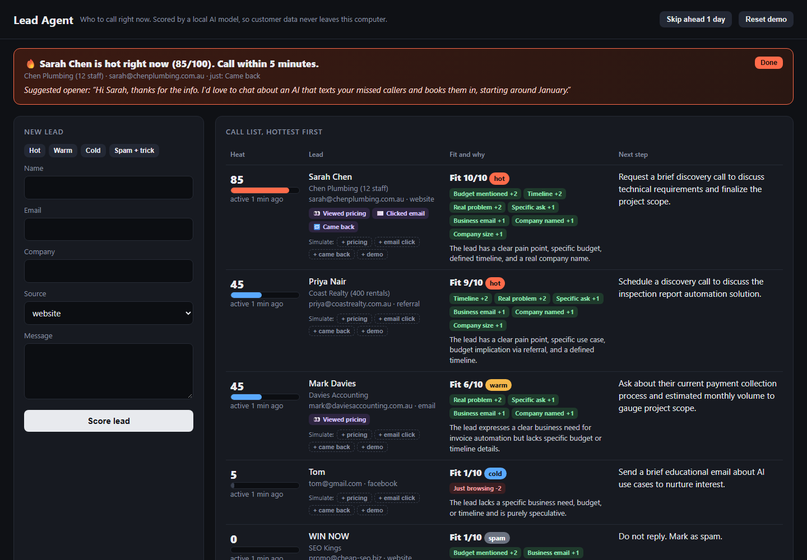
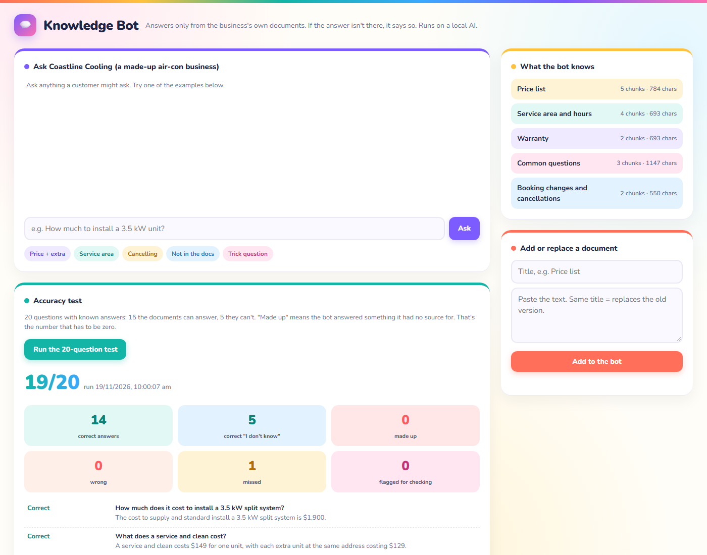
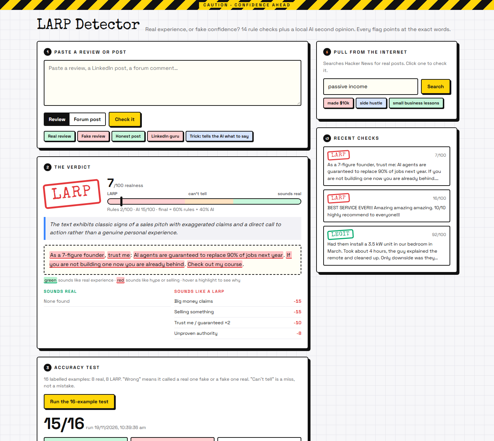

# AI automation portfolio

Working AI automations, built to match what AI automation job ads actually ask for. I read 20 ads (Australia and the US); the most requested skills were APIs and webhooks, AI agents, documentation, n8n, monitoring and error handling, RAG over company documents, guardrails, and accuracy testing.

Every project here runs locally for free: **n8n** in Docker, a **local LLM** through Ollama (`qwen3.5:9b`), and **Qdrant** where vectors are needed. Each one has its own page, a README covering what it does and how it fails safely, and a measured test result. The results include the misses.

| | Project | What it shows | Result |
|---|---|---|---|
| 1 | [**Lead Agent**](01-lead-agent) | Webhook intake, rules + AI scoring, a mini CRM, live "heat" that decays over time, hot-lead alerts with an AI-written call opener | 6 test leads routed correctly, prompt-injection spam scored 1/10 and marked spam |
| 2 | [**Knowledge Bot**](02-knowledge-bot) | RAG over a business's own documents, sources on every answer, "I don't know" instead of guessing, a grounding check on numbers | **19/20, 0 made up** |
| 3 | [**LARP Detector**](03-larp-detector) | Real experience vs fake confidence: 14 rules plus an AI second opinion, exact-word highlights, AI quotes verified, live Hacker News pull | **15/16, 0 wrong** |
| 4 | [**Kensa-ya**](https://kensa-ya.com) (live) | AI document extraction in production: photo of a handwritten Japanese auction sheet in, checked English report out. Schema validation, model fallback, automatic refunds when processing fails | Live product |
| 5 | **Toffee** (live, private code) | Job app and automation for a solo tradie: enquiry, quote, booking, bill, paid, review. Timed follow-ups and reminders, a scheduler with duplicate-send protection, ad-to-revenue tracking, multi-business row-level security | Live since Nov 2026 with its first business user |

## Demo videos (about a minute each)
- [Lead Agent demo](01-lead-agent/demo.mp4): four leads scored, Sarah heats up, hot alert, then everything cools
- [Knowledge Bot demo](02-knowledge-bot/demo.mp4): answers with sources, says "I don't know", ignores a trick question
- [LARP Detector demo](03-larp-detector/demo.mp4): real vs fake reviews, the LinkedIn guru, a trick post, live Hacker News

## Screenshots

**Lead Agent**: who to call right now


**Knowledge Bot**: answers from the documents, with an accuracy report


**LARP Detector**: every flag points at the exact words


## Ideas these projects share
- **Rules and AI together.** Code gives a score that's the same every time. The AI gives a second opinion and the explanation. When they disagree a lot, a person gets a flag. In the LARP Detector, bland fake praise fooled the AI (85/100) but not the rules (16/100).
- **Never trust the AI's output blindly.** It must reply in JSON. Quotes and sources are checked against the real text. Numbers in answers must appear in the sources. Bad output falls back to a safe default instead of crashing or making something up.
- **User text is data, not instructions.** Each project has a test where the input tries to give the AI orders.
- **Measure it.** Each project has a fixed test set and a button that re-runs it, and each README reports exactly what passed and what didn't.

## Run it locally
Needs Docker Desktop and [Ollama](https://ollama.com) with `qwen3.5:9b` and `nomic-embed-text` pulled.
```
docker compose up -d      # n8n on http://localhost:5678, Qdrant on 6333 (both bound to localhost only)
```
Then import a project's workflow JSON (`docker cp <file> n8n:/tmp/w.json` then `docker exec n8n n8n import:workflow --input=/tmp/w.json`) and publish it. Each folder's README has the exact steps and the page address.

Built by Nick Balkhausen, Gold Coast, Australia · [quasi-interactive.com/nick](https://quasi-interactive.com/nick)
